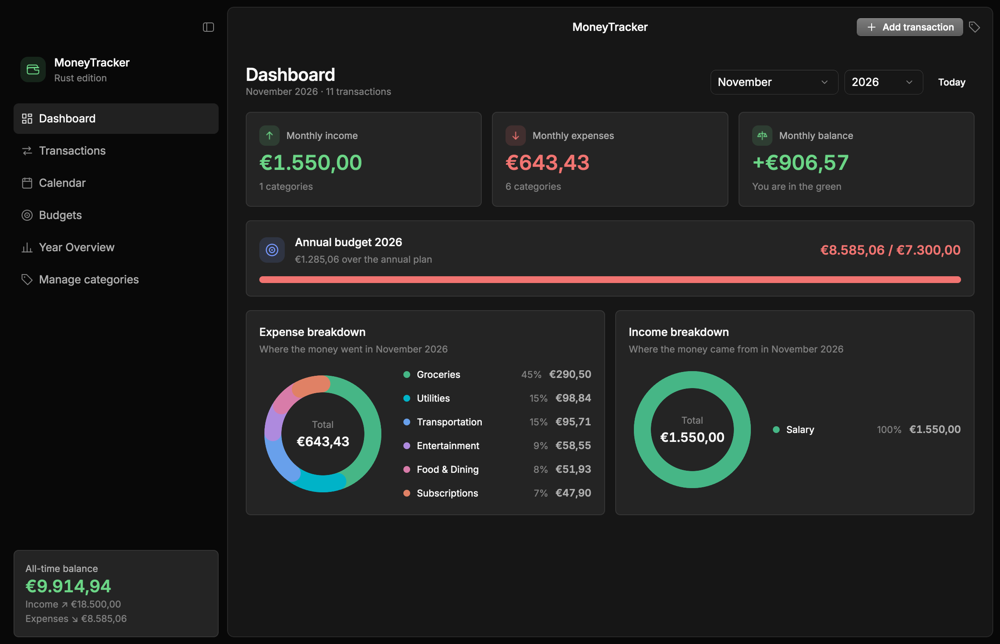
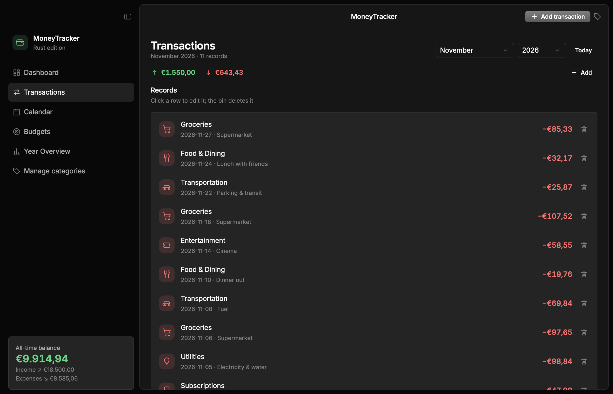
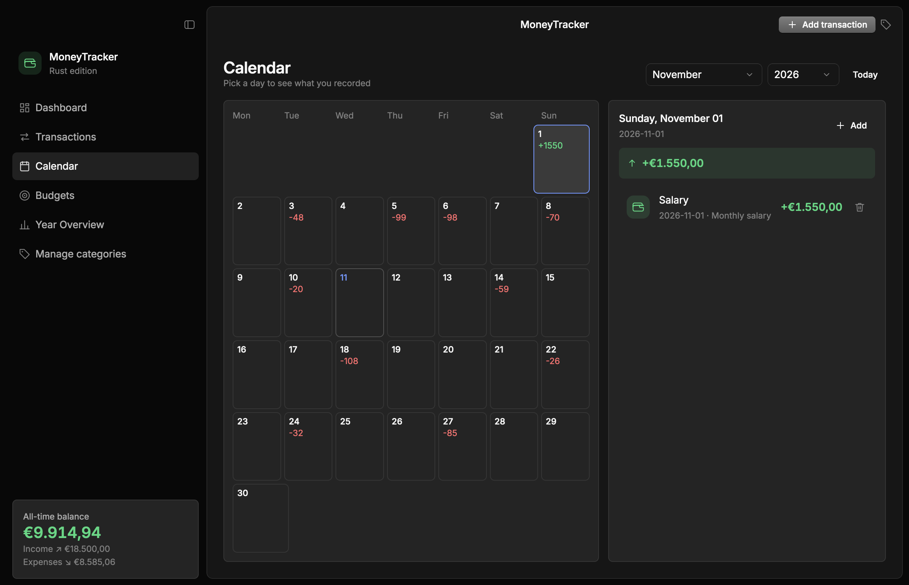
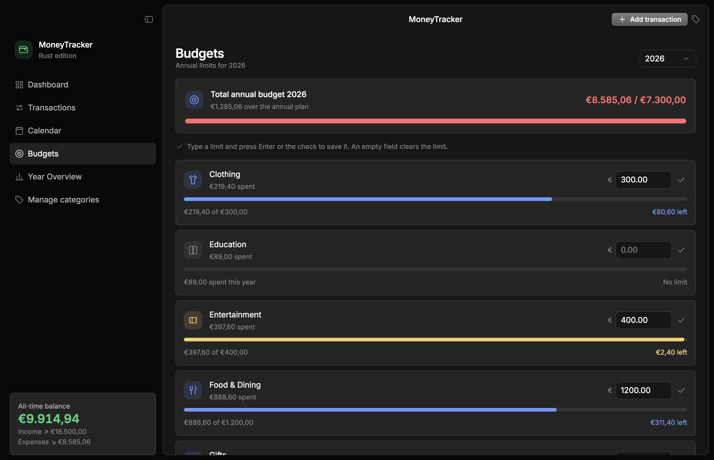
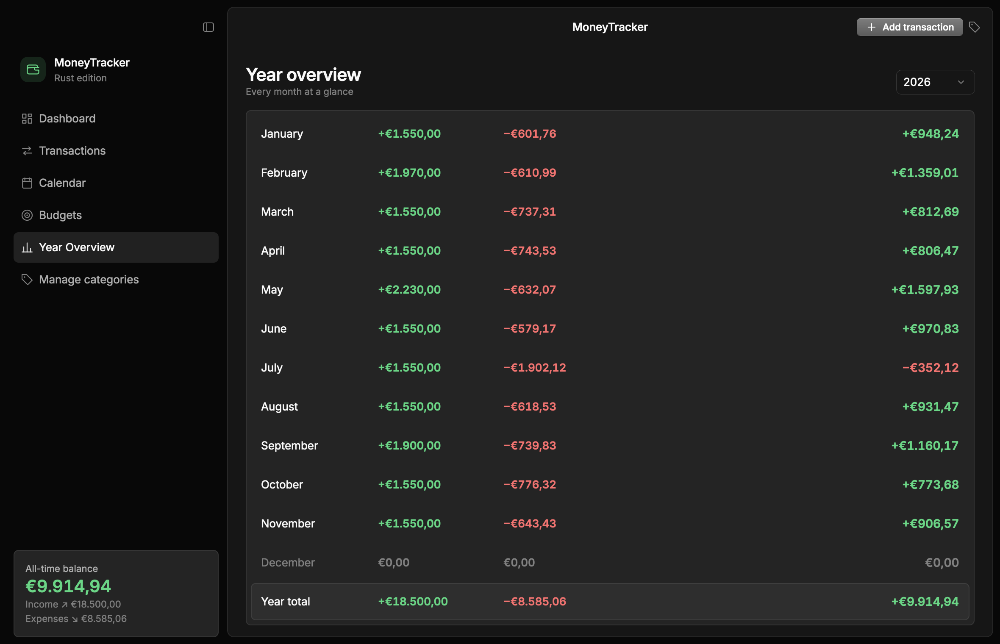

# MoneyTracker 4

A personal-finance desktop app written in Rust with [Rune](https://github.com/anomalyco/rune), opencode's native UI toolkit. It reads and writes the same SQLite database as the original Python version, so the two apps can take turns on the same file — no migration, no lock-in.

## Screenshots

| Dashboard | Transactions |
| --- | --- |
|  |  |

| Calendar | Budgets | Year overview |
| --- | --- | --- |
|  |  |  |

*Rendered headlessly against a demo database with fictional data — no personal figures ever leave the machine.*

## Features

- **Dashboard** – monthly income, expenses and balance; annual budget progress; expense/income breakdowns as donuts with a legend.
- **Transactions** – every record of the selected month; click a row to edit it, the bin deletes it.
- **Calendar** – the month grid with each day's totals and the selected day's records.
- **Budgets** – one annual limit per expense category, edited inline and saved with Enter or the check.
- **Year overview** – the twelve months with income, expenses and balance, plus a year total.
- **Excel export** – one keystroke (<kbd>Ctrl</kbd>+<kbd>E</kbd>) writes an `.xlsx` workbook with six charts, a filterable transactions table and the aggregates behind them; see [Excel export](#excel-export).

Every time-scoped screen has dropdown pickers for **month** and **year** (a single year picker on the annual views) that update the page immediately; the default is always the current month/year, and a *Today* button jumps back to it. The toolbar adds a transaction (<kbd>Ctrl</kbd>+<kbd>N</kbd>), exports to Excel (<kbd>Ctrl</kbd>+<kbd>E</kbd>) and opens the category manager; <kbd>Ctrl</kbd>+<kbd>Shift</kbd>+<kbd>B</kbd> shows/hides the sidebar.

## Requirements

- Windows (developed and packaged for Windows)
- Rust — the exact toolchain is pinned in `rust-toolchain.toml` (1.99.1); rustup installs it automatically on first build
- No system dependencies: SQLite ships bundled with `rusqlite`, so there is nothing else to install

## Quick start (development)

```powershell
cargo run            # debug build, opens the project's data\moneytracker.db
cargo run --release  # optimized build
```

The first build compiles Rune from its pinned git revision (`Cargo.toml`) and takes a few minutes; later builds are incremental.

### Where the database lives

1. `MT_DB_FILE` if set;
2. `data/moneytracker.db` beside the executable;
3. for a `cargo run` build (binary under `target/debug|release`), the project's own `data/moneytracker.db`, so development never writes into `target/`.

A missing database is created and seeded on first launch with 22 default categories (14 expense, 8 income).

## Excel export

`Ctrl`+`E` (or the toolbar's **Export Excel**) opens an Italian-language dialog with two optional year fields — `Da anno` and `A anno` — and a grid of monthly checkboxes (`Gennaio` … `Dicembre`) with a `Tutti` checkbox that selects or clears all twelve; the `Tutti` box shows a mixed state when only some months are selected. Then comes the native save dialog, proposing `MoneyTracker-YYYY-MM-DD.xlsx`. Leave the years empty and every month checked to export the whole history. At least one month is required.

The workbook has three sheets:

| Sheet | Contents |
| --- | --- |
| `Grafici` | Six charts with Italian titles: monthly and yearly income/expenses/balance columns, expense and income category donuts, and one monthly line chart per direction with a line for every category. |
| `Transazioni` | A real Excel Table named `Transazioni`: frozen header, autofilter, and a `Totale` row built from `SUBTOTAL(109, …)` so it follows the filters. Columns: `Data, Anno, Mese, Tipo, Categoria, Descrizione, Entrate, Uscite, Saldo, ID, Creato il`; money columns are formatted as euros. |
| `Dati` | Hidden. The month × category matrices and summary tables the charts point at, written as `SUMIFS` formulas over `Transazioni` with cached results, so the workbook opens already populated and recalculates when the data changes. |

The period narrows the KPIs and the donuts, and line charts leave a gap outside the selected months; the monthly chart follows the year range only, and the yearly chart always shows every year. Dates in the grid stay ISO text (`YYYY-MM-DD`), so the table sorts and filters lexically. An empty database still produces a valid workbook: headers, a *Nessun dato da esportare* note and no half-drawn charts.

## Building the release exe

```powershell
.\package.ps1                  # build release, run the tests, refresh dist\
.\package.ps1 -SkipTests       # same without cargo test
.\package.ps1 -ForceDb         # also replace dist\data\moneytracker.db with data\moneytracker.db
.\package.ps1 -DbSource <path> # publish a specific database file instead (implies -ForceDb)
.\package.ps1 -SkipSmokeTest   # do not launch the published binary once
```

`dist\` ends up with `MoneyTracker4.exe` and `data\moneytracker.db` side by side — that is all the app needs: double-click the exe and it opens the database next to it.

If PowerShell refuses to run the script because of the execution policy, call it explicitly:

```powershell
powershell -ExecutionPolicy Bypass -File .\package.ps1
```

The script never overwrites an existing `dist\data\moneytracker.db`, since that one holds live data; on the first run it seeds the folder from the development copy. After copying, it launches the published exe once with `--snap` and checks that it renders a frame, so a broken binary or a missing database does not go unnoticed.

## Database

One SQLite file shared with the Python original — same schema, same SQL strings, same semantics (amounts rounded to two decimals, UUID v4 ids, local ISO timestamps):

| Table | Columns |
| --- | --- |
| `categories` | `id`, `name` (unique), `type` (`income`/`expense`) |
| `transactions` | `id` (UUID), `type`, `amount`, `category`, `description`, `date`, `created_at`; indexed on date, type and category |
| `budgets` | `year`, `category`, `amount` — unique per `(year, category)` |

Categories carry the emoji in their stored name (`"🍔 Food & Dining"`); a few legacy rows have an emoji-less duplicate. The UI groups by display name (emoji stripped) and never rewrites those rows; budgets are stored on one canonical spelling per group.

**Your data stays yours.** `data/*.db` and `dist/` are git-ignored, so the repository contains no personal figures — a fresh clone gets an empty seeded database on first launch.

## Layout of the code

| File | Contents |
| --- | --- |
| `src/db.rs` | A 1:1 port of `data_manager.py`: schema, seed, queries, summaries, budgets. |
| `src/model.rs` | Domain types, money formatting, category display names (emoji stripped). |
| `src/export.rs` | Excel workbook: period filters, aggregates, the transactions table, the six charts. |
| `src/state.rs` | `App`: what the views read and the handlers that change it. |
| `src/ui/` | The window shell and one module per view, plus `widgets.rs` and `dialogs.rs`. |
| `src/icons.rs` | The SVG icon set and the category → icon mapping. |
| `src/main.rs` | `AppSpec`: window, fonts, theme, shortcuts. |

Views are plain functions of `App`; Rune re-renders them every frame and the element handlers mutate the state. Modals use `rune_kit::Dialog`, including focus trapping and Escape.

## Tests

```powershell
cargo test
```

Fourteen inline unit tests in `src/db.rs`, `src/model.rs` and `src/export.rs`: throwaway-database round trips, fresh-DB seeding, budget lifecycle, money formatting, emoji stripping, legacy-spelling merge, month names, period and month-set filtering (including multi-month `SUMIFS`), and workbook smoke tests (sheets, table totals, chart ranges, empty database). They never touch the live database.

## Headless snapshots

Rune can render a single frame without a window; the app understands a few environment variables so snapshots can show real data (this is also how the screenshots above are produced):

```powershell
$env:MT_DB_FILE="C:\path\to\db"               # which database to open
$env:MT_SNAP_MONTH="2026-10"                  # month to open
$env:MT_SNAP_DAY="2026-10-25"                 # selected calendar day
$env:MT_SNAP_DIALOG="add|categories|edit|delete|export"
cargo run -- --snap shot.png --theme dark --size 1180x760 --view dashboard
```

`--view` accepts `dashboard`, `transactions`, `calendar`, `budgets`, `year`.
